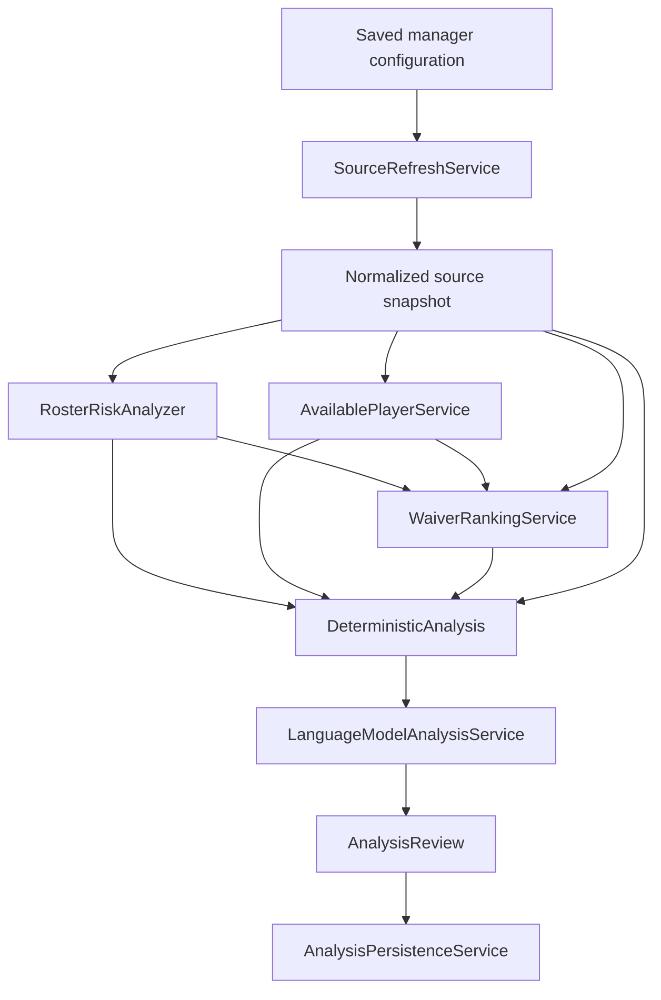
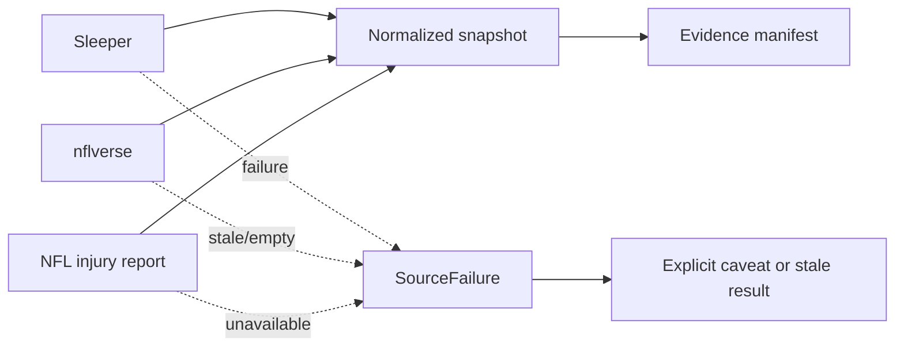
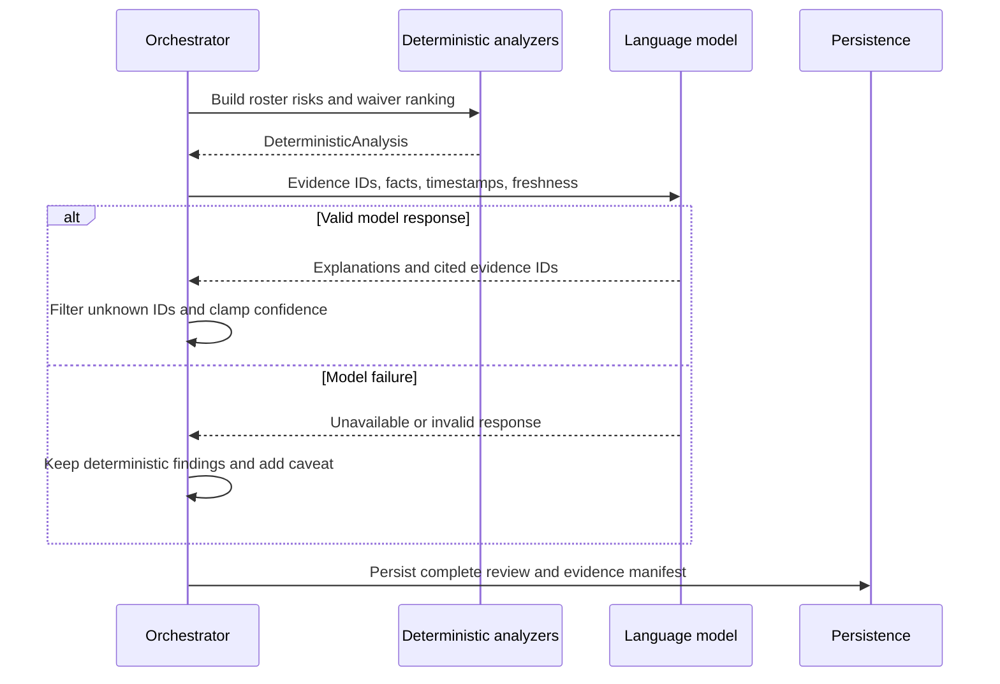

# Analysis behavior

The analysis pipeline is the core of Sleeper Fantasy Advisor. It turns a
configured Sleeper league into an explainable roster review and waiver ranking.
The pipeline is deterministic first: external model output can add context,
but it cannot replace source facts or deterministic recommendations.

## End-to-end flow

`AnalysisOrchestrator` coordinates this flow:

1. Load the configured league, roster, and season.
2. Refresh Sleeper, performance, schedule, usage, and injury data.
3. Normalize successful responses into a `LeagueSnapshot` and evidence items.
4. Evaluate roster risks.
5. Derive the available-player pool.
6. Rank waiver candidates.
7. Send only normalized evidence to the language-model provider.
8. Merge valid contextual explanations with the deterministic result.
9. Persist the review, evidence manifest, freshness metadata, and confidence.

## Source refresh and evidence

`SourceRefreshService` calls the provider interfaces rather than depending on
provider-specific response shapes. The refresh includes:

- Sleeper league, settings, rosters, players, state, matchups, transactions,
  and trending players.
- nflverse schedules, weekly performance, and usage data.
- Current injury and practice reports.

Each normalized evidence item contains:

| Field | Meaning |
| --- | --- |
| `EvidenceId` | Stable identifier used by explanations and persisted manifests |
| `Provider` | Source that supplied the observation |
| `EvidenceType` | `rosters`, `injury`, `performance`, `usage`, etc. |
| `SubjectKey` | League, player, or collection represented by the evidence |
| `Fact` | Serialized normalized value |
| `ObservedAt` | When the source response was observed |
| `FreshUntil` | Source-specific freshness deadline |
| `IdentityKey` | Canonical identity used for matching |
| `Availability` | Available, empty, rate-limited, unavailable, or invalid |

Provider failures are retained as `SourceFailure` records. A partial refresh
does not silently become a complete refresh: the resulting review carries the
failure, stale, unavailable, or incomplete state forward.

## Roster-risk behavior

`RosterRiskAnalyzer` evaluates the selected roster against the current league
state and week.

For each rostered player it considers:

- Whether the player is a starter.
- Current injury and game status.
- Practice participation.
- Whether the player's team has a game in the current week.
- Recent fantasy performance when available.
- Missing team, injury, practice, or performance signals.

Risk codes identify actionable conditions such as:

- `injury`
- `injury-risk`
- `bye`

Unavailable signals are recorded separately. Missing data does **not** imply
that a player is healthy, active, or projected to score.

If the league is pre-draft, offseason, or complete, the analyzer returns an
unavailable review with the league state and an explanation instead of
presenting an empty in-season review.

## Available-player behavior

`AvailablePlayerService` builds the waiver pool from the league's current
roster snapshot:

1. Collect every player ID present on every league roster.
2. Exclude those rostered IDs.
3. Exclude inactive, blank, malformed, or unsupported player records.
4. Apply the league's configured position eligibility.
5. Mark each remaining player with the snapshot timestamp and evidence
   completeness.

Flex positions permit the supported flex positions (`RB`, `WR`, and `TE`).
If roster ownership cannot be verified because the roster snapshot is
incomplete, the pool is marked incomplete and candidates are not represented
as fully verified availability.

## Waiver ranking behavior

`WaiverRankingService` produces an advisory, deterministic ranking. It does
not submit claims or perform any Sleeper write operation.

The score combines:

- Roster need, especially a starter affected by a bye or injury.
- Recent fantasy performance when present.
- Usage or role evidence such as snaps, routes, or touches.
- Injury-related opportunity signals.
- League scoring settings, including reception scoring.
- Evidence completeness and conflicts.

Each recommendation includes:

- Priority and deterministic score.
- Position and roster-fit reasons.
- Evidence IDs when available.
- Conflicts between signals.
- Confidence.
- A stale marker when the availability snapshot is incomplete or outdated.

An opportunity candidate is described as a possible replacement, not a
guaranteed outcome. Missing performance, injury, or role evidence lowers
confidence and is shown as unavailable rather than fabricated.

## Language-model boundary

`LanguageModelAnalysisService` sends a compact `LanguageModelRequest` containing
normalized evidence and an instruction to explain only the supplied facts.

The response is accepted only as contextual analysis:

- Evidence IDs not present in the request are removed.
- Finding confidence is clamped to the supported range.
- Explanations without valid evidence remain non-authoritative.
- Model caveats and conflicts are retained.
- A model timeout, rejection, unavailable response, or invalid response does
  not remove deterministic roster or waiver findings.

## Persistence and failure behavior

`AnalysisPersistenceService` stores:

- The completed analysis result.
- The serialized deterministic and contextual review.
- Evidence rows with provider, identity, availability, timestamps, and stale
  state.
- A source manifest containing evidence IDs and source freshness.
- Overall confidence and stale markers.

When persistence records a failed execution, it updates the run status and
error metadata only. It does not create an empty successful result. A previous
successful result remains available for fallback and comparison.

```mermaid
stateDiagram-v2
    [*] --> Refreshing
    Refreshing --> Deterministic: Required snapshot available
    Refreshing --> Partial: Optional source failed
    Refreshing --> Failed: Required snapshot unavailable
    Partial --> Deterministic: Continue with explicit failures
    Deterministic --> Contextual: Send evidence bundle
    Contextual --> Persisting: Model succeeds
    Contextual --> Persisting: Model fails; retain deterministic result
    Persisting --> Completed
    Failed --> Failed: Preserve prior successful result
```

## Code map

| Responsibility | Implementation |
| --- | --- |
| Normalized analysis types | `src/SleeperFantasy.Domain/Analysis/AnalysisModels.cs` |
| Source refresh | `SourceRefreshService.cs` |
| Roster risks | `RosterRiskAnalyzer.cs` |
| Available players | `AvailablePlayerService.cs` |
| Waiver ranking | `WaiverRankingService.cs` |
| LLM bundling and merge | `LanguageModelAnalysisService.cs` |
| Pipeline orchestration | `AnalysisOrchestrator.cs` |
| Review persistence | `AnalysisPersistenceService.cs` |
| Unit tests | `tests/SleeperFantasy.ProviderTests/*Analysis*Tests.cs` |

